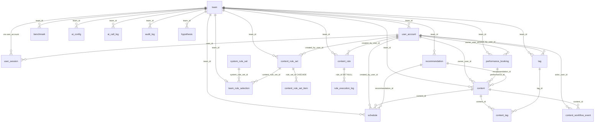

# 数据库说明（PostgreSQL）

> 本文档以仓库中实际存在的 SQL、Go 数据模型和运行中的 Schema 为依据。所有表、字段、
> 约束、索引和迁移都经过 `pg_catalog` 核对，不是根据文件名推测。

## 1. 数据库概述

- **引擎与版本**：PostgreSQL 16（Docker 镜像 `postgres:16-alpine`；`db/init/01_schema.sql`
  使用 `\getenv` / `\gexec` 等 psql 指令，需要 PostgreSQL 16 自带的 `psql`）。
- **业务职责**：保存团队私有内容资产、正式演出、排期计划、规则集、统计基准、模型配置与
  审计记录。全部业务表都带 `team_id`，服务端按登录会话中的团队过滤，业务数据不跨团队。
- **与 Go 后端的关系**：后端（`cmd/api`）是唯一写入口。它使用非超级用户 `arts_app`
  通过 `DATABASE_URL` 连接，启动时用 advisory lock 应用 `internal/migrate/sql` 中的版本化
  迁移，迁移失败则不启动 HTTP 服务。所有参数校验、权限校验与业务规则都在 Go 层完成。
- **与前端的关系**：浏览器不直接连接数据库，只访问同源 `/api`；数据库不暴露到宿主机
  （Compose 中 `db` 服务只加入内部 `db-net`，没有 `ports` 映射）。前端环境变量里不包含任何
  数据库地址、账号或口令。
- **时间语义**：`planned_date` 是 `DATE`，表示纯日历日期；`starts_at`、`published_at` 等是
  `TIMESTAMP WITHOUT TIME ZONE`，表示团队本地墙上时间。容器通过 `TZ`（默认
  `Asia/Shanghai`）对齐，避免日期跨日偏移。

## 2. 目录结构

```text
db/
├── init/                   # 仅由官方 PostgreSQL 镜像在“数据卷为空”时执行
│   ├── 01_schema.sql       # 首次建表：完整 Schema + 最小权限应用角色 + 标记 0001_initial
│   └── 02_seed_data.sh     # 初始化包装脚本：按 LOAD_EXAMPLE_DATA 决定是否导入样例
├── sql/                    # 手工运维脚本
│   ├── create_database.sql # 手工建库（连接维护库执行）
│   └── 02_seed_data.sql    # 可选虚构样例数据（幂等），标记 0002_seed_rules
└── README.md               # 本文件
```

仓库里同时存在两套结构来源，职责不同，请勿混淆：

| 来源 | 何时执行 | 当前状态 |
| --- | --- | --- |
| `db/init/01_schema.sql` | 仅新数据卷首次初始化 | 标准流程的一部分：建出与 Go 迁移等价的基线，并写入 `schema_migrations('0001_initial')`，让 API 继续应用后续迁移 |
| `db/sql/02_seed_data.sql` | 仅新数据卷首次初始化且 `LOAD_EXAMPLE_DATA=true`；也可手工重跑 | 可选样例，不是生产数据；幂等，不会覆盖既有团队数据 |
| `internal/migrate/sql/*.sql` | 每次 API 启动 | 唯一的标准升级路径；新增或变更结构一律追加迁移文件 |
| `db/sql/create_database.sql` | 需要手工建库时 | 运维脚本；Docker 已自动建库时不要重复执行 |

`db/init/02_seed_data.sh` 只是包装：`LOAD_EXAMPLE_DATA=true` 时用
`psql --file /docker-entrypoint-sql/02_seed_data.sql` 导入，否则打印提示并跳过。

## 3. 数据表清单

缩写：PK=主键，FK=外键，UQ=唯一约束，CK=检查约束。`SERIAL`/`BIGSERIAL` 由序列生成；
UUID 列由 Go 后端用 `uuid.NewString()` 生成。

### team（团队）

业务用途：团队工作区，所有业务数据的隔离边界。字段：`id`（SERIAL PK）、`name`
VARCHAR(100)、`created_at`。数据产生：`POST /api/auth/setup`、`POST /api/auth/register-team`。
序列由 `0004_restore_team_id_sequence` 修正（样例数据使用了显式 id）。

### user_account（成员账号）

业务用途：团队成员与角色（`owner`/`editor`/`viewer`）。字段：`id`（SERIAL PK）、`team_id`
（FK→team）、`email` VARCHAR(254)（唯一索引 `ix_user_account_email`）、`name`、`role_name`、
`password_hash`（PBKDF2-SHA256，格式 `pbkdf2_sha256$salt$digest`，不回显给浏览器）、
`created_at`。数据产生：`POST /api/auth/setup`、`POST /api/users`（仅负责人）。

### user_session（登录会话）

业务用途：Bearer token 对应的服务端会话，可吊销。字段：`id` VARCHAR(36) PK（写入 token
的 `sid`）、`user_id`（FK→user_account）、`expires_at`、`revoked`。数据产生：登录时创建；
`POST /api/auth/logout` 置 `revoked=true`。

### content（内容资产 / 预热视频）

业务用途：一条宣发/预热视频的全生命周期记录，是核心业务表。

| 字段 | 类型 | 含义 |
| --- | --- | --- |
| id | VARCHAR(36) PK | 内容 ID（UUID） |
| team_id | INTEGER FK→team | 所属团队 |
| title | VARCHAR(300) | 标题 |
| category | VARCHAR(40) | 内容类型：演出宣传/技艺展示/幕后记录/艺术科普 |
| platform | VARCHAR(100) | 发布平台 |
| published_at | TIMESTAMP | 计划或实际发布时间 |
| duration | INTEGER | 时长（秒） |
| views / likes / comments / saves / shares | INTEGER | 播放 / 点赞 / 评论 / 收藏 / 转发 |
| completion | FLOAT | 看完比例（0–100） |
| total_interactions | INTEGER | 赞+评+藏+转之和（后端计算写入） |
| tags_json | TEXT | 标签快照（JSON 文本；权威关系见 `content_tag`） |
| source | VARCHAR(30) | 来源：`manual` / `auto` / `example` |
| lifecycle | VARCHAR(20) | 发布结果：已发布/未发布，受 `ck_content_lifecycle_two_states` 约束 |
| materials / cover_url / owner / notes | TEXT, VARCHAR | 素材说明 / 封面 / 负责人显示名 / 备注 |
| profile_visits / follows / attendance / tickets | INTEGER | 转化数据：主页访问 / 新增关注 / 到场 / 售票 |
| comment_text | TEXT | 评论摘要（团队自行录入） |
| adopted | BOOLEAN | 是否采纳过排期建议 |
| recommendation_id | VARCHAR(36) FK→recommendation | 来源建议（可空） |
| performance_id | VARCHAR(36) FK→performance_booking | 所属正式演出（可空）。一条内容同一时间只能归属一场演出 |
| owner_user_id | INTEGER FK→user_account | 负责人 |
| workflow_state | VARCHAR(20) | 工作流：待制作/已制作/待排期/已排期/已发布，受 `ck_content_workflow_state_values` 约束 |
| created_by / created_at / updated_at | VARCHAR(100), TIMESTAMP | 审计字段 |

重要区分：`lifecycle` 是**发布结果**，`workflow_state` 是**工作流阶段**。「待排期/已排期」
属于工作流，**不是**已发布；只有 `lifecycle='已发布'` 的内容计入效果统计。

索引：`ix_content_team_id`、`ix_content_performance_id`、`ix_content_owner_user_id`、
`ix_content_workflow_state`、`ix_content_published_at`。 数据产生：`POST /api/contents`
（新记录强制从「待制作」开始）、`PATCH /api/contents/{id}`、工作流推进
`POST /api/contents/{id}/advance`、排期回填 `POST /api/schedule/{id}/publish`。

### performance_booking（正式演出）

业务用途：一场正式演出，作为预热视频的分组容器与排期倒计时基准。

| 字段 | 类型 | 含义 |
| --- | --- | --- |
| id | VARCHAR(36) PK | 演出 ID |
| team_id | INTEGER FK→team | 所属团队 |
| title | VARCHAR(300) | 演出名称 |
| venue | VARCHAR(200) | 演出地点（可空字符串） |
| starts_at | TIMESTAMP | 演出时间；排期不得晚于它 |
| booking_status | VARCHAR(30) | 状态：筹备中/预热中/已演出/已取消，受 `ck_performance_booking_status` 约束 |
| performance_type | VARCHAR(60) | 演出类型（剧种/类别），`0008` 新增 |
| ticket_link | TEXT | 票档或购票链接，`0008` 新增 |
| owner_user_id | INTEGER FK→user_account | 负责人 |
| notes | TEXT | 备注 |
| created_at | TIMESTAMP | 创建时间 |

状态规则（服务端在读取列表、详情、总览前结算）：`筹备中`/`预热中` 且 `starts_at` 已过 →
自动改为 `已演出`；`已取消` 是终态，永不自动改写。

索引：`ix_performance_booking_team_id`、`ix_performance_booking_starts_at`、
`ix_performance_booking_owner_user_id`、`ix_performance_booking_team_starts_at`。
数据产生：`POST /api/performances`、`PATCH /api/performances/{id}`、
`DELETE /api/performances/{id}`（删除时仅解除内容关联，不删除内容）。

### schedule（排期计划）

业务用途：一条内容的发布计划与发布后对照数据，也是日历、时间轴、排期完成率的来源。

| 字段 | 类型 | 含义 |
| --- | --- | --- |
| id | VARCHAR(36) PK | 排期 ID |
| team_id | INTEGER FK→team | 所属团队 |
| recommendation_id | VARCHAR(36) FK→recommendation | 来源建议（采纳生成时写入） |
| content_id | VARCHAR(36) FK→content | 关联内容；删除内容时后端先删除其排期 |
| planned_date | DATE | 计划日期（纯日历日期） |
| planned_time | VARCHAR(10) | 计划时间 `HH:MM` |
| title / category / platform / owner / reason | VARCHAR, TEXT | 计划展示字段与推荐理由 |
| status | VARCHAR(20) | `待发布` / `已复盘` |
| source | VARCHAR(20) | `auto`（生成或采纳）或 `manual`（人工创建或调整） |
| created_by_user_id | INTEGER FK→user_account | 操作人 |
| actual_views … actual_completion | INTEGER, FLOAT | 回填的实际数据（可空） |
| prediction_views_low / high | INTEGER | 预测区间（可空） |
| created_at / updated_at | TIMESTAMP | 审计字段 |

数据产生：`POST /api/schedule/manual`、`POST /api/schedule/manual-batch`、
`POST /api/schedule/adopt`（事务内校验）、`PATCH /api/schedule/{id}`（人工调整，同时写
`audit_log`）、`POST /api/schedule/{id}/publish`（回填实际数据并同步内容资产）。

### recommendation（排期建议）

业务用途：一次排期建议生成的结果快照。字段：`id`（VARCHAR(36) PK）、`team_id`（FK→team）、
`generated_at`、`payload_json`（`{"recommendations":[…]}`，整场排期额外带
`performance_id`）、`source_model`、`source_label`、`confidence`、`reference_count`、
`analysis_status`（如 `ai_completed`/`rule_fallback`/`performance_plan`/`no_candidates`）、
`fallback_reason`、`adopted`。数据产生：`POST /api/ai/recommend`、
`POST /api/performances/{id}/plan`、`PATCH /api/recommendations/{id}`。

### content_rule_set（自定义规则集）

业务用途：团队可编辑的规则集（`0006` 新增）。字段：`id`（SERIAL PK）、`team_id`（FK→team）、
`name` VARCHAR(120)、`description` TEXT、`created_by_user_id`（FK→user_account）、
`created_at`、`updated_at`。约束 `uq_content_rule_set_team_name (team_id, name)` 保证同团队
不重名；索引 `ix_content_rule_set_team_id`。数据产生：`POST /api/rules/sets`。

### content_rule_set_item（规则集条目）

业务用途：自定义规则集里的一条规则。字段：`id`（SERIAL PK）、`rule_set_id`
（FK→content_rule_set，**ON DELETE CASCADE**）、`name`、`priority`（默认 100）、`enabled`、
`rule_type`（`required`/`format`/`sensitive_words`/`length`/`tag_constraint`）、
`rule_content`（JSON 文本，默认 `{}`）、`content_type`、`workflow_state`、`notes`、
`created_at`、`updated_at`。索引 `ix_content_rule_set_item_set_id`。

### content_rule（历史团队校验规则）

业务用途：迁移前的团队级校验规则表，后端内容保存校验仍会读取；`0006` 会把已有行整理为
「团队校验规则集」。字段：`id`（SERIAL PK）、`team_id`（FK→team）、`name`、`priority`、
`enabled`、`trigger`、`logic`、`conditions_json`、`scope_json`、`actions_json`、`rule_type`、
`rule_content`、`content_type`、`workflow_state`、`notes`、`created_by_user_id`、
`updated_by_user_id`（均 FK→user_account）、`created_at`、`updated_at`。新功能不建议再写
这张表。

### system_rule_set（系统规则集，只读）

业务用途：随服务发布的版本化只读规则来源，包含内容治理规则与排期策略。

| 字段 | 类型 | 含义 |
| --- | --- | --- |
| id | BIGSERIAL PK | 规则集 ID |
| name | VARCHAR(160) | 名称；`system_rule_set_name_version_key (name, version)` 唯一 |
| version | VARCHAR(40) | 版本（当前 `1.1`） |
| payload_json | JSONB | 规则内容：`rules[]`、`schedule_policy`、`status_convention` 等 |
| enabled | BOOLEAN | 是否启用（默认 true） |
| updated_at | TIMESTAMPTZ | 更新时间（默认 now()） |

当前内置记录名为 `系统规则集`（`0007_system_rule_set_name` 由「艺数智策·内容运营规则集」
重命名而来，保留主键、版本、payload 与 enabled）。该表**没有** `team_id`：它是服务级只读
数据，所有团队可读，但不能通过应用 API 修改或删除。

### team_rule_selection（当前生效规则集）

业务用途：每个团队选择唯一一个生效规则集（系统或自定义二选一）。字段：`team_id`
（INTEGER PK，FK→team **ON DELETE CASCADE**）、`system_rule_set_id`（FK→system_rule_set）、
`content_rule_set_id`（FK→content_rule_set）、`updated_by_user_id`（FK→user_account）、
`updated_at`。检查约束 `ck_team_rule_selection_target` 保证两个目标列恰好一个非空。
数据产生：`PUT /api/rules/effective`；未选择时服务端回退到最新启用的系统规则集。

### rule_execution_log（规则执行日志）

业务用途：规则命中轨迹。字段：`id`（SERIAL PK）、`team_id`（FK→team）、`rule_id`
（FK→content_rule **ON DELETE SET NULL**，规则删除后保留日志）、`rule_name`、`content_id`、
`trigger`、`result`、`detail`、`created_at`。

### tag（标签）与 content_tag（内容-标签关系）

`tag`：团队标签库。字段：`id`（SERIAL PK）、`team_id`（FK→team）、`name` VARCHAR(50)、
`normalized_name` VARCHAR(100)、`color`、`is_active`、`created_by_user_id`（FK）、
`created_at`。约束 `uq_tag_team_normalized_name (team_id, normalized_name)` 保证忽略大小写
与全半角差异后的唯一性；`is_active=false` 表示停用（历史内容仍保留关联）。

`content_tag`：内容与标签的多对多关系，联合主键 `(content_id, tag_id)`，两侧外键均
**ON DELETE CASCADE**。

### content_workflow_event（工作流事件）

业务用途：每次工作流状态变更的审计轨迹。字段：`id`（SERIAL PK）、`team_id`（FK→team）、
`content_id`（FK→content **ON DELETE CASCADE**）、`from_state`、`to_state`、`source`
（`manual`/`system`）、`actor_user_id`（FK→user_account）、`created_at`。
索引：`ix_content_workflow_event_content_id`、`ix_content_workflow_event_team_id`。

### benchmark（团队自身基准）

业务用途：按内容类型/平台的团队历史中位数，只代表本团队。字段：`id`（SERIAL PK）、
`team_id`（FK→team）、`category`、`platform`、`completion_median`、`interaction_median`、
`source_type`。数据产生：样例导入或 `PUT /api/benchmark`。

### ai_config（模型接口配置）

业务用途：团队的大模型接口配置与评分权重。字段：`id`（SERIAL PK）、`team_id`（FK→team）、
`name`、`base_url`、`api_key`（由 `APP_SECRET` 派生密钥 AES-GCM 加密后存储，前缀
`enc:v1:`，不回显给浏览器）、`model`、`temperature`、`request_mode`、`auth_type`、
`enabled`、`fallback_enabled`、`score_completion_weight`、`score_interaction_weight`、
`min_sample`、`platform_weights_json`、`updated_at`。

### ai_call_log（模型调用日志）

业务用途：模型调用的输入/输出摘要、耗时与状态（不记录密钥）。字段：`id`（SERIAL PK）、
`team_id`（FK→team）、`created_at`、`input_summary`、`output_summary`、`elapsed_ms`、`status`。

### audit_log（操作审计）

业务用途：业务动作审计，也承载排期人工调整记录。

| 字段 | 类型 | 含义 |
| --- | --- | --- |
| id | SERIAL PK | 日志 ID |
| team_id | INTEGER FK→team | 所属团队 |
| actor | VARCHAR(100) | 操作人姓名 |
| action | VARCHAR(60) | 如 `create`/`update`/`delete`/`adopt_schedule`/`adjust_schedule`/`link_performance` |
| entity_type / entity_id | VARCHAR(50) / VARCHAR(80) | 实体类型与 ID（如 `performance`、`content`、`schedule`） |
| detail | TEXT | 说明；`adjust_schedule` 记录「调整前 / 调整后」 |
| created_at | TIMESTAMP | 记录时间 |

`GET /api/schedule/{id}/adjustments` 读取 `action='adjust_schedule'` 的行，即为该排期的人工
调整历史。

### hypothesis（运营假设）

业务用途：可验证的运营假设与结论。字段：`id`（VARCHAR(36) PK）、`team_id`（FK→team）、
`statement`、`result`、`status`、`created_at`。

### schema_migrations（迁移元数据）

业务用途：已应用的迁移版本。字段：`version` VARCHAR(160) PK、`applied_at` TIMESTAMPTZ
（默认 now()）。由 `db/init/01_schema.sql`（`0001_initial`）、`db/sql/02_seed_data.sql`
（`0002_seed_rules`）与 Go 迁移运行器共同维护。

## 4. 表关系图



基数：`||--o{` 一对多，`||--o|` 一对一（可空）。

由**业务逻辑**而非数据库外键维护的关联（迁移时请留意）：

- `recommendation.payload_json` 内的 `target_content_id` 指向 `content.id`，但该列是 JSON
  文本，数据库不校验；采纳时由 Go 端逐条校验。
- `team_rule_selection` 的「二选一」由检查约束保证，服务端读取时还会确认目标规则集仍存在
  且启用。
- `content_tag` 与 `content.tags_json` 互为冗余：`content_tag` 是权威关系，`tags_json` 是
  历史快照，由后端在同一事务内同步。
- `schedule.owner` / `content.owner` 是负责人显示名快照；权威关联是 `owner_user_id`。
- `system_rule_set` 不做团队外键关联：它对所有团队可见且只读。

## 5. 初始化和迁移

### 首次建库（Docker，标准流程）

1. Compose 以 `POSTGRES_DB`（默认 `arts_smart`）和 `POSTGRES_USER`（默认 `arts_admin`）
   创建数据库与超级用户。
2. 数据卷 `arts-smart-postgres-data` **为空**时，官方镜像按文件名顺序执行
   `/docker-entrypoint-initdb.d`：`01_schema.sql`（建表、创建 `arts_app` 角色并授权、写入
   `schema_migrations('0001_initial')`），随后 `02_seed_data.sh`。
3. `LOAD_EXAMPLE_DATA=true`（默认）时导入 `db/sql/02_seed_data.sql`：1 个团队、120 条内容、
   2 场演出、若干标签/排期/基准/系统规则集，并写入
   `schema_migrations('0002_seed_rules')`。样例数据**不创建账号**，首次访问网页时创建团队
   管理员。
4. API 启动时获取 advisory lock，读取 `internal/migrate/sql`，跳过已记录版本，按顺序应用
   `0003` 及之后的迁移，成功后通过 readiness 检查。

| 版本 | 作用 |
| --- | --- |
| 0001_initial | 基线表结构（与 `db/init/01_schema.sql` 等价） |
| 0002_seed_rules | 内置只读系统规则集 `1.1` |
| 0003_remove_import_only_rules | 移除已废弃的文件导入相关规则 |
| 0004_restore_team_id_sequence | 修正样例显式 id 造成的 `team` 序列落后 |
| 0005_canonical_workflow_states | 工作流状态归一为五态，历史 `未发布` 按真实情况映射 |
| 0006_rule_sets | 新增 `content_rule_set`、`content_rule_set_item`、`team_rule_selection`，把历史 `content_rule` 整理为「团队校验规则集」 |
| 0007_system_rule_set_name | 系统规则集重命名为「系统规则集」，保留主键/版本/启用状态/规则内容 |
| 0008_performance_management | 演出表新增 `performance_type`、`ticket_link`，统一演出状态口径并加检查约束与 `(team_id, starts_at)` 索引 |

### 更新已有数据库

部署新版本并重启 API 即可，迁移会自动补齐且保留数据（例如 `0007` 只做 `UPDATE` 改名，
`0008` 用 `ADD COLUMN IF NOT EXISTS` 与状态归一 `UPDATE`）。不要为升级结构删除数据卷。

### 容器重启与数据卷持久化

初始化脚本**只在新数据卷上执行一次**；`docker compose restart`、`up -d` 或容器重启都不会
重跑 `db/init`。数据保存在命名卷 `arts-smart-postgres-data` 中。修改 `db/init/*.sql` 对已有卷
不生效——这类改动必须写成 `internal/migrate/sql` 的新迁移。

### 手工建库与装载

仅在没有 Docker 自动初始化时使用（命令见第 7 节）。`db/init/01_schema.sql` 依赖 psql 的
`\getenv`/`\gexec`，需要 `APP_DB_USER`、`APP_DB_PASSWORD` 环境变量，不能当作通用 SQL 文件
执行。

## 6. 连接配置

环境变量只在后端 `.env` / Compose 环境中定义，**不会**出现在 `web/.env`：

| 变量 | 用途 | 默认 / 示例 | 备注 |
| --- | --- | --- | --- |
| POSTGRES_DB | 数据库名 | `arts_smart` | 建库与所有连接串必须一致 |
| POSTGRES_ADMIN_USER | 初始化用超级用户 | `arts_admin` | 仅用于初始化与运维 |
| POSTGRES_ADMIN_PASSWORD | 超级用户口令 | 必填 | 只存于 `.env`，勿提交 |
| APP_DB_USER | 应用账号（非超级用户） | `arts_app` | 后端连接使用 |
| APP_DB_PASSWORD | 应用账号口令 | 必填 | 只存于 `.env`，勿提交 |
| DATABASE_URL | 后端连接串 | `postgresql://arts_app:…@db:5432/arts_smart?sslmode=disable` | 容器内主机名是 `db`；本机开发用 `localhost` |
| LOAD_EXAMPLE_DATA | 是否导入样例 | `true` | 只影响空数据卷的首次初始化 |
| TZ | 团队时区 | `Asia/Shanghai` | 决定「演出到期」判定与日期渲染 |

Docker 内部网络：`db` 服务只加入内部网络 `db-net`，无宿主机端口；`api` 同时加入 `app-net`
（供 `web` 访问）与 `db-net`（访问数据库）。因此：

- 容器内地址是 `db:5432`。
- 本机开发（Go 直连）不能用 `db`，需用 `localhost:5432`；若数据库只在容器内，需自行建立
  端口转发。
- 三服务器部署时使用数据库服务器的私有 IP 或 VPN 地址，并在防火墙只放行 API 主机；跨
  不可信网络应配置 TLS 并使用 `sslmode=require`。

不要把真实密码、Token 或密钥写入本文档或任何前端配置。

## 7. 数据维护

### 备份

```text
docker compose exec -T db pg_dump -U arts_admin -d arts_smart -Fc -f /tmp/arts_smart.dump
docker compose cp db:/tmp/arts_smart.dump ./arts_smart.dump
docker compose exec -T db pg_dump -U arts_admin -d arts_smart > arts_smart.sql
```

第一段是自定义格式备份（可用 `pg_restore` 灵活恢复），第二段是纯 SQL 文本备份。
前提：数据库 healthy；建议先 `docker compose stop api` 以获得一致快照。
风险：`-Fc` 备份需要相同或更高版本的 `pg_restore`。

### 恢复

```text
docker compose exec -T db psql -U arts_admin -d postgres -v ON_ERROR_STOP=1 -c "CREATE DATABASE arts_smart_restore OWNER arts_app"
docker compose cp ./arts_smart.dump db:/tmp/arts_smart.dump
docker compose exec -T db pg_restore -U arts_admin -d arts_smart_restore --no-owner /tmp/arts_smart.dump
```

风险：使用 `--clean` 或把备份恢复到正在使用的库会**覆盖现有数据**。恢复前确认目标库名，
不要作用于正式库。

### 状态与结构检查

```text
docker compose exec -T db psql -U arts_admin -d arts_smart -c "SELECT version, applied_at FROM schema_migrations ORDER BY version;"
docker compose exec -T db psql -U arts_admin -d arts_smart -c "\d+ performance_booking"
```

### 手工建库与初始化（无 Docker 自动初始化时）

```text
psql -U arts_admin -d postgres -v ON_ERROR_STOP=1 -f db/sql/create_database.sql
APP_DB_USER=arts_app APP_DB_PASSWORD=请替换 psql -U arts_admin -d arts_smart -v ON_ERROR_STOP=1 -f db/init/01_schema.sql
psql -U arts_admin -d arts_smart -v ON_ERROR_STOP=1 -f db/sql/02_seed_data.sql
```

最后一行是可选的样例数据导入。`02_seed_data.sql` 可重复执行（唯一键冲突忽略，内容样例仅在
团队尚无内容时生成）。

## 8. 常见故障

| 现象 | 原因 | 处理 |
| --- | --- | --- |
| API 报 `database is starting`，readiness 失败 | 数据库未 healthy，或库内角色口令与 `.env` 不一致 | `docker compose ps` 等 `db` healthy；`docker compose logs db`；必要时 `docker compose exec db psql -U arts_admin -d arts_smart`，用 `\password arts_app` 改成与 `.env` 完全相同的值，再 `docker compose up -d api` |
| `password authentication failed for user "arts_app"` | `.env` 的 `APP_DB_PASSWORD` 与库内角色口令不同 | 同上。镜像只在**空数据卷**时按环境变量创建角色，改 `.env` 不会自动改库内口令 |
| `relation "xxx" does not exist` | 初始化脚本没跑（卷非空），或迁移失败 | 查 `schema_migrations`；`docker compose logs api` 找失败迁移；不要手工建表绕过迁移 |
| 违反外键约束 | 引用了其他团队或已删除的演出/内容，或直接删除仍被引用的行 | 通过 API 操作（后端会在同一事务内先删排期再删内容）；不要直接用 SQL 删 `content` |
| 迁移失败后 API 不启动 | 迁移出错会回滚该版本并终止启动，这是设计行为 | 修复后**追加新迁移**；不要改已应用文件的内容或文件名（会被当成新版本重复执行）；不要手工删 `schema_migrations` 里已提交的版本 |
| Schema 与代码不一致 | 直接改过库，或手工执行过 `db/init` 的表结构 | 用 `internal/migrate/sql` 的新迁移把库拉回一致；`db/init/01_schema.sql` 只服务新装环境 |
| 本机连不上数据库 | 本机 `DATABASE_URL` 用了容器内主机名 | 本机用 `localhost:5432` 并确保端口可达；`db` 只在容器网络内可解析 |
| 演出状态没有自动变成「已演出」 | 容器时区与团队时区不一致（`TZ` 未设置） | 设置 `TZ`（默认 `Asia/Shanghai`）并重建 API / DB 容器；状态结算使用应用时间与 `starts_at` 的墙上时间比较 |
| 想「重来一遍」样例数据 | 需要清空数据卷 | 仅在确认可丢弃全部数据时 `docker compose down -v`；这会删除命名卷内全部业务数据，请先备份 |

## 9. 与代码的对应关系

| 数据库对象 | 代码位置 |
| --- | --- |
| 表结构与迁移 | `internal/migrate/sql/*.sql`、`internal/migrate/migrate.go` |
| 数据访问 | `internal/repository/postgres.go`、`content.go`、`schedule.go`、`workflow.go`、`performance.go`、`auth.go` |
| HTTP 契约 | `internal/httpapi/*.go`，接口描述见 `api/openapi.yaml` |
| 计划规则与窗口 | `internal/domain/schedule.go`、`internal/domain/workflow.go` |
| 排期建议与整场排期 | `internal/service/advisor.go`、`internal/service/performance_plan.go` |
